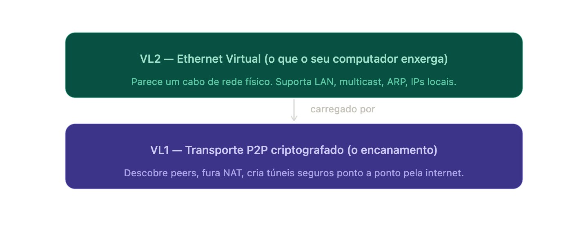
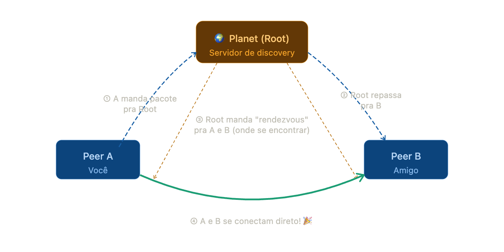
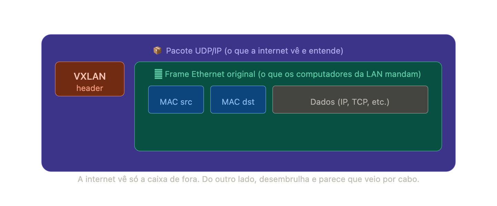

Vou explicar o ZeroTier como se você tivesse 10 anos, com um diagrama pra cada parte.

---

## O que é o ZeroTier?

Imagina que você e seus amigos moram em cidades diferentes, mas querem jogar numa LAN party — aquele tipo de jogo onde todo mundo precisa estar na mesma rede, como se estivessem no mesmo quarto com um cabo ligando os computadores.

O ZeroTier faz exatamente isso, mas pela internet. Ele finge que vocês estão todos num mesmo escritório gigante, conectados por fios, mesmo estando no mundo inteiro.

---

## As duas camadas: VL1 e VL2

O ZeroTier funciona em dois andares.

**VL1** é o encanamento — ele resolve "como dois computadores se acham na internet e criam um túnel secreto entre eles." É ele quem faz o trabalho sujo de furar firewalls e NATs.

**VL2** é o andar de cima — depois que o túnel existe, ele finge ser um cabo Ethernet de verdade. Seu computador nem percebe que não é um fio físico.

---

## Os "Planets" e "Moons" — o sistema de discovery

Aqui é onde entra o que você chamou de "oracle". No VL1, a rede é organizada como o DNS. Na base ficam os **root servers**, cujo papel é parecido com os servidores raiz do DNS.

Existe apenas um **planet** — os root servers da Terra, operados pelo ZeroTier Inc. como serviço gratuito. São quatro servidores espalhados pelo globo. Um **moon** é uma forma conveniente de adicionar root servers próprios ao pool — você pode criar moons para reduzir dependência da infraestrutura da ZeroTier, ou para ter root servers mais próximos.

O fluxo de descoberta é assim:

---

## O que é VXLAN — e como o VL2 é parecido

Agora a parte mais interessante: **VXLAN**.

Imagina que você tem uma rede de computadores física (Ethernet), com cabos de verdade. Eles se comunicam na **camada 2** do OSI — que é o nível mais baixo, antes mesmo de falar em IPs. É o nível dos endereços MAC, de pacotes Ethernet brutos.

O problema: quando você quer "esticar" essa LAN pela internet, a internet só entende IP (camada 3). Ela não sabe o que fazer com frames Ethernet.

A solução do VXLAN é: **pega o pacote Ethernet, envolve ele num pacote UDP/IP, manda pela internet, e do outro lado desembrulha.** É como colocar uma carta dentro de outra carta.

O ZeroTier faz algo **parecido** com o VXLAN, mas com diferenças importantes:

- VXLAN normal precisa de infraestrutura dedicada (switches físicos, VTEPs)
- O VL2 do ZeroTier roda em cima do VL1 já criptografado, com discovery automático
- Não é VXLAN de verdade — é *similar* ao VXLAN, mas o protocolo ZeroTier é original. Aspectos dele se parecem com VXLAN e também com IPSec.

---

## O controller — o "dono da rede"

Cada rede VL2 é identificada por um **Network ID** de 64 bits, que contém o endereço ZeroTier do **controller** da rede mais um número de 24 bits identificando a rede nesse controller.

O controller é como o zelador do condomínio: ele decide quem entra, emite certificados para os membros, e define as regras. Controllers são análogos aos SDN controllers em protocolos como OpenFlow, mas isso não quer dizer que os protocolos ou o design sejam iguais.

Um ponto importante que muita gente confunde: root servers são facilitadores de conexão que operam no nível VL1. Network controllers são gerenciadores de configuração e autoridades certificadoras que pertencem ao VL2. Em geral, root servers não entram nem controlam redes virtuais, e controllers não são root servers — embora seja possível ter um nó fazendo os dois papéis.

---

## Resumo

O ZeroTier é um switch Ethernet gigante e planetário. O VL1 é o fio que conecta tudo, o VL2 é a ilusão de que vocês estão todos no mesmo escritório, os planets/moons são as listas telefônicas que ajudam a se achar, e o VXLAN é a técnica de "colocar Ethernet dentro de IP" que inspira o VL2.
